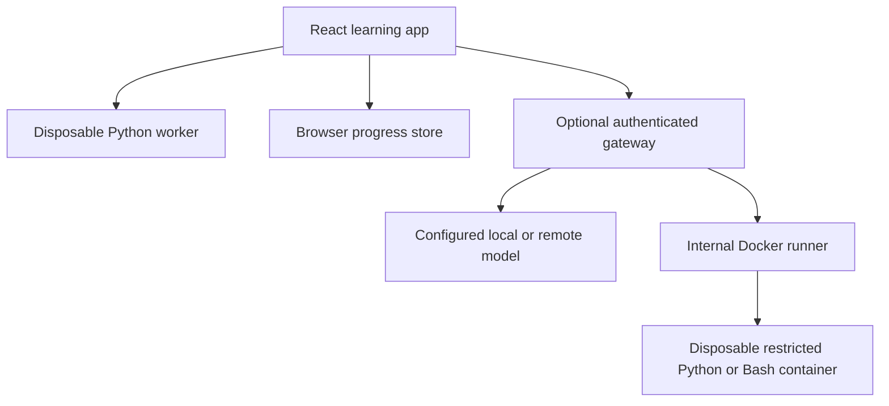

# Architecture and trust boundaries

The static application is the product's baseline. It imports authored curriculum and deterministic practice models at build time. The Python runtime is copied from the locked npm package into the build, so normal practice makes no CDN request. Loading still requires the static assets; this release has no service worker or guaranteed offline installation.

Browser progress is local, unencrypted and editable. Import validates shape, limits record counts and string lengths, and rejects reserved object keys. Export/import is the backup mechanism. There are no accounts, cloud progress stores, analytics or tracking scripts.

## Execution and grading

- Linux terminal and shell/cron configuration missions use an explicit teaching model. Configuration checks accept the syntax taught by the exercise, not every semantically equivalent shell program.
- Python missions run real Python via Pyodide in a dedicated worker that is terminated after each run. A 60-second wall-clock cap protects responsiveness. A worker is not a strong security boundary: browser Python can access JavaScript APIs through Pyodide, and memory pressure can affect the tab. Do not run untrusted pasted programs or keep secrets in the learning origin.
- Docker Python and Bash are optional, with no network, host mounts or added capabilities. Containers have a read-only root, non-root learner UID, CPU/memory/PID limits, bounded output and a 10-second deadline. The default seccomp profile remains in force.
- Practice checks are shipped with the content and are inspectable. Learner code can subvert checks running in its interpreter. This is deliberate self-study evidence, not an anti-cheat or certification system. Production assessments require a separate external validator.

## Optional mentor

The API accepts a fixed mission identifier and bounded question/code/output. It supplies authored lesson context to an OpenAI-compatible `/chat/completions` endpoint. It grants the model no tools and never uses a model response to mark a mission passed. Structured answer text is rendered by React as text, not raw HTML.

Capabilities require a successful `/models` response containing the configured model. Some nominally compatible providers do not expose this endpoint or support every parameter. Those providers require an adapter; a configuration value alone does not turn on the tutor.

Requests send the lesson, question, current code and recent output to the selected provider. Provider keys remain environment variables in the gateway. Backend bearer tokens stay in tab memory. The backend URL is operator-configured; the browser cannot choose an arbitrary upstream provider URL. Upstream redirects are refused to avoid forwarding authorization to another host.

The gateway uses explicit CORS origins, constant-time token comparison, four concurrent optional-service slots, size limits and upstream timeouts. Empty `API_TOKEN` only permits loopback clients. In Docker, requests arrive from nginx on the container network, so set a token before using optional features. A failed tutor or runner leaves all standalone features usable.

## Lab-host boundary

The opt-in runner has access to a Docker daemon socket. That socket confers broad authority over that daemon. Container flags do not make socket access safe for a shared workstation or a hostile public service. Use a dedicated lab VM/daemon, preferably rootless, without valuable workloads or credentials. The application API never mounts that socket.

This v0.2 deployment targets one trusted learner on a local host. It does not implement internet-facing account authentication, tenant isolation, distributed rate limiting, VM lifecycle management, billing or a hardened public sandbox. Bound ports to loopback by default. Use TLS, authentication and a dedicated isolated runner before exposing optional services beyond that boundary.

## Deployment shapes

| Mode | Runtime | Model | Executable Python | Host incident simulation |
|---|---|---|---|---|
| GitHub Pages | Static assets | None by default; own gateway optional | Browser worker | Browser model |
| Docker core | nginx + Python gateway | Optional | Browser worker | Browser model |
| Docker labs profile | Core + isolated runner/daemon | Optional | Browser or Docker | Browser model; full VM labs planned |

Design Lab capacity and latency are illustrative equations, not calibrated load-test measurements. The interface exposes these assumptions.

Primary technical references: [Ollama compatibility](https://docs.ollama.com/api/openai-compatibility), [Docker security](https://docs.docker.com/engine/security/), [rootless Docker](https://docs.docker.com/engine/security/rootless/), and [GitHub Pages workflows](https://docs.github.com/en/pages/getting-started-with-github-pages/using-custom-workflows-with-github-pages).

## Curriculum and progress contracts

`src/lib/curriculum.mjs` is the executable mission contract. Build and test commands validate field limits, check types, concepts, references and prerequisite cycles. Browser terminal/config checks interpret a fixed set of data descriptors; they never evaluate JavaScript from content. Authoring previews validate JSON but do not execute imported Python or Bash.

Progress schema v2 retains the original storage key for automatic in-place migration. Legacy attempts refer to content version 1. New attempts snapshot content version and concept keys. The review schedule is derived deterministically from exported attempt evidence; failure/help resets to one day and consecutive independent passes extend to 3/7/14/30 days. Separate mission IDs establish transfer evidence. Updating a mission version preserves earlier portfolio records while requesting fresh practice.

Bash source is serialized into a trusted Python harness as data, written to a temporary file, and invoked as an argument array with `bash --noprofile --norc`. Repository-authored cases check exact output and exit status, including empty arguments and wildcard characters. Each case has a two-second subprocess deadline within the container's overall ten-second deadline. No browser-supplied tests or arbitrary mission definitions reach the runner. Health reports installed language images separately; missing Bash does not disable Python.
