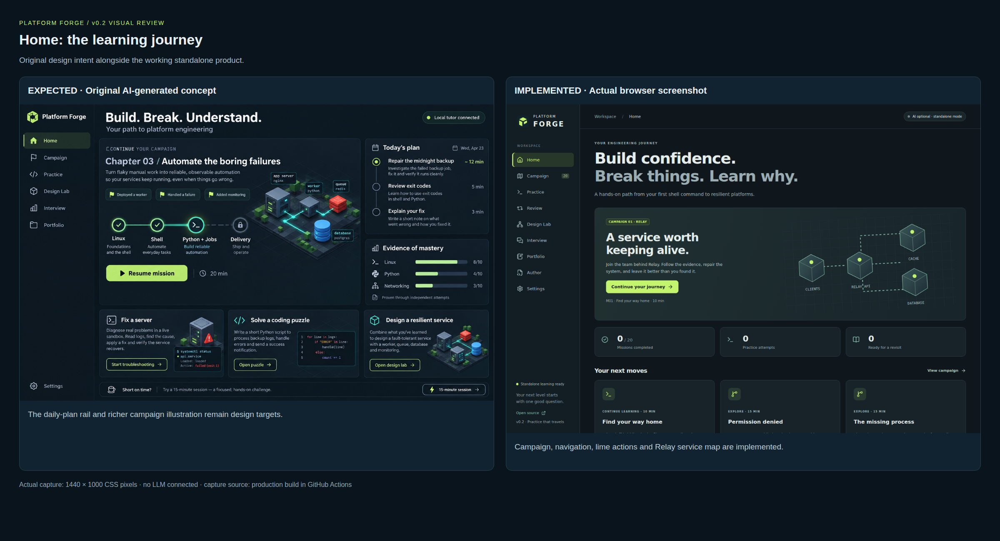
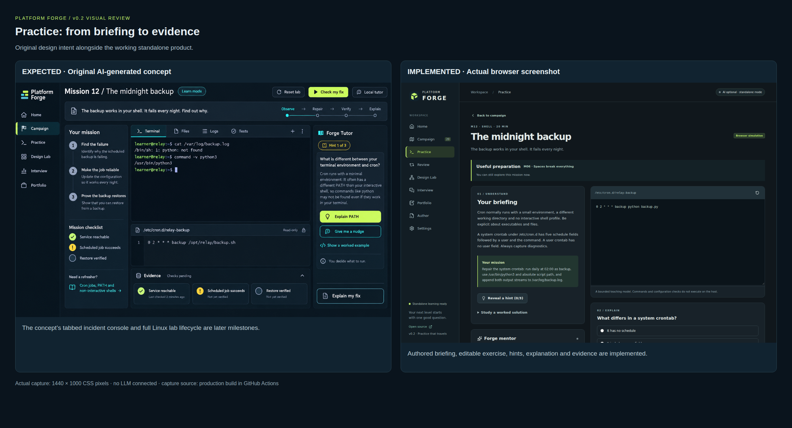
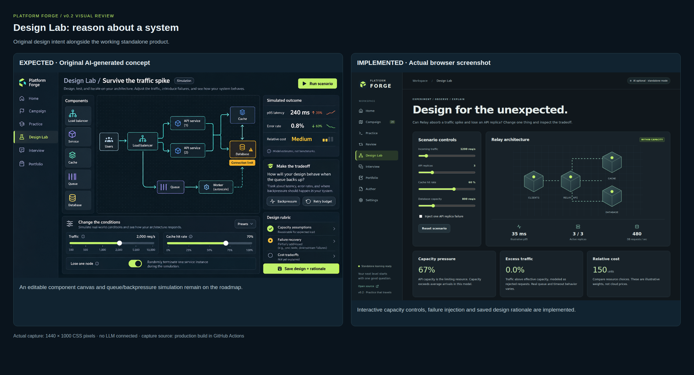
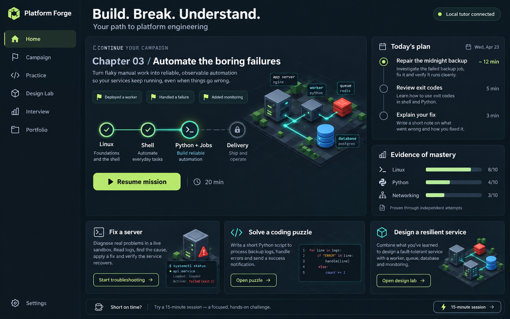
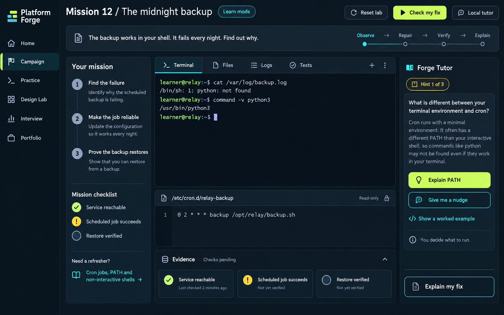
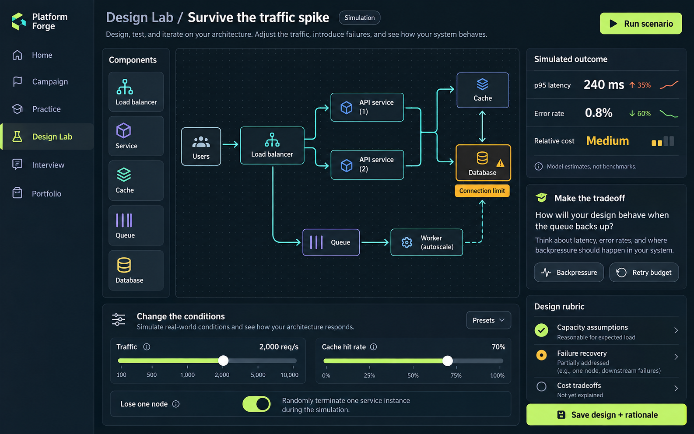

# Design concepts versus working product

The three original AI-generated images are design targets, not screenshots. The actual product captures are generated by Playwright from the release build at a fixed desktop viewport; they are not AI renderings. The `browser-review` artifact on CI includes individual screens and labeled comparison boards.

| Screen | Intent retained | Current implementation | Remaining visual/product work |
|---|---|---|---|
| Home | Dark navy, lime actions, persistent navigation, Relay campaign | Working mission continuation, counts, recommendations and service map | Daily plan rail, richer campaign path and isometric illustration |
| Mission | Briefing, workspace, hints, evidence | Two-column practice, executable Python, optional Bash, explanation and handoff | Tabbed terminal/files/logs, staged incident checklist, full Linux lab lifecycle |
| Design Lab | Change conditions, inject failure, explain tradeoffs | Sliders, capacity model, topology, visible assumptions and saved rationale | Drag-and-drop components, queue/backpressure models and richer scenario library |
| Review | Evidence-based learning | Concept schedule, independent practice and transfer variants | Practitioner-calibrated scheduling and longitudinal learning feedback |
| Author | Extensible original curriculum | Validated JSON editor, lesson preview, import/export | Structured form editor and editorial collaboration |

The standalone captures show the tutor disconnected. The original concepts show an optional tutor-connected state. Review screenshots use explicitly labeled test-fixture progress, not a real learner's activity.

## Release comparison boards

Captured from commit `74844cc5253eb723a734fc13f759b77f757065a0` by [successful browser and Docker CI](https://github.com/rclevenger-hm/Platform_Forge/actions/runs/38350034472). The original images are on the left; actual browser screenshots are on the right.

### Home

### Mission workspace

### Design Lab

Full captures: [Home](screenshots/v0.2/home-full.png), [Practice](screenshots/v0.2/mission-full.png), [Design Lab](screenshots/v0.2/design-full.png), [Review with demo progress](screenshots/v0.2/review.png), [Author](screenshots/v0.2/author.png).

## Original Home concept

## Original mission concept

## Original Design Lab concept

